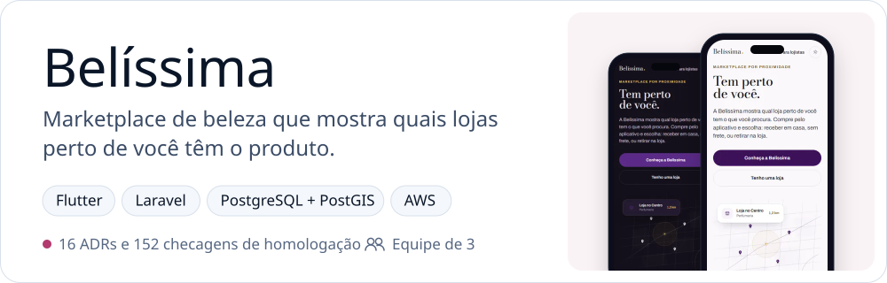
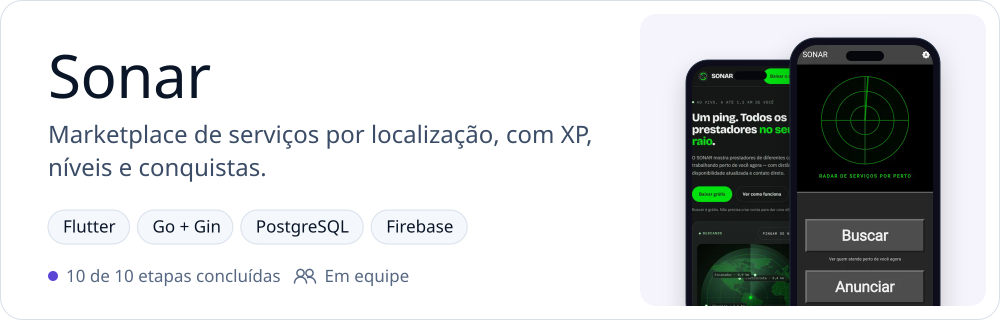
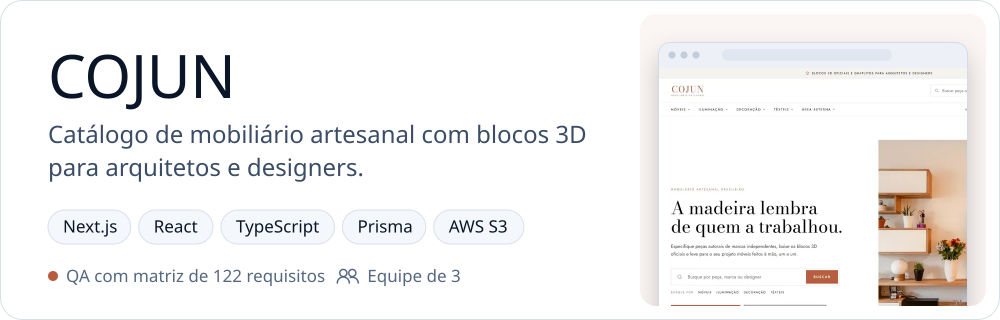
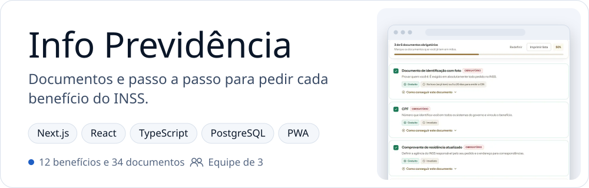
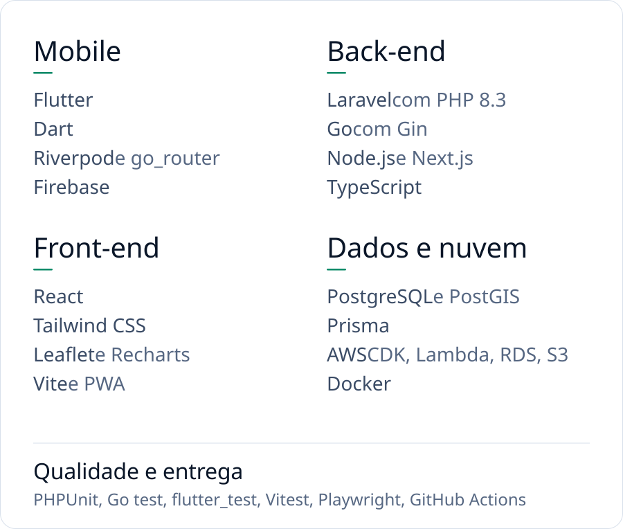

  

  Desenvolvo aplicativos Flutter e sistemas web para clientes, trabalhando em equipe:
  marketplaces com geolocalização, monitoramento de usinas solares e plataformas de catálogo,
  com back-end em Laravel, Go e Next.js sobre PostgreSQL e AWS.

  <a href="https://educosta2405.github.io/portifolio/"><picture><source media="(prefers-color-scheme: dark)" srcset="assets/buttons/portfolio-dark.svg"></picture></a>&nbsp;
  <a href="mailto:edu.sousabsb@gmail.com"><picture><source media="(prefers-color-scheme: dark)" srcset="assets/buttons/email-dark.svg"></picture></a>

## Sistemas em destaque

Projetos de clientes, construídos em equipe, com o código em repositórios privados.
Abra os detalhes de cada um para ver o que foi construído e a minha parte.

<picture><source media="(prefers-color-scheme: dark)" srcset="assets/projects/belissima-dark.svg"></picture>

<b>Belíssima</b>: o que foi construído e a minha parte

 

- App Flutter para consumidor e lojista, com painel administrativo e API em Laravel.
- Busca por proximidade: o consumidor vê as lojas perto dele que têm o produto e escolhe retirar ou receber em casa.
- Catálogo com variantes de produto, carrinho com produtos de várias lojas, pedidos e avaliações.
- Decisões registradas em 16 ADRs, testes automatizados no CI e um verificador de homologação com 152 checagens.
- **Minha parte:** 132 dos 191 commits, incluindo a landing page, as correções encontradas na homologação e o registro de entregas.
- **Situação:** em desenvolvimento, ainda não lançado.

<picture><source media="(prefers-color-scheme: dark)" srcset="assets/projects/sonar-dark.svg"></picture>

<b>Sonar</b>: o que foi construído e a minha parte

 

- Evolução de uma base existente até um marketplace de serviços por localização, em 10 etapas, todas concluídas.
- Gamificação com XP, níveis e conquistas, com regras contra ganho abusivo de pontos aplicadas no servidor.
- Conversa dentro do app, avaliações, bloqueio e denúncia, tema claro e escuro e CI para API, Android, web e iOS.
- **Minha parte:** 80 dos 170 commits, com o sistema de gamificação (API e app), a conversa, as avaliações, a moderação e o CI.

<picture><source media="(prefers-color-scheme: dark)" srcset="assets/projects/spotview-dark.svg"></picture>

<b>SpotView</b>: o que foi construído e a minha parte

 

- Monitoramento de usinas solares de vários fabricantes, com coleta automática dos dados de cada inversor.
- Mapa operacional com o estado de cada usina, metas mensais com sazonalidade, modo TV para a sala de operação, relatórios e manutenções.
- Acesso separado por empresa, com papéis e trilha de auditoria.
- **Minha parte:** 68 dos 127 commits, com a coleta de dados, as metas, o mapa e o modo TV e a operação em produção.

<picture><source media="(prefers-color-scheme: dark)" srcset="assets/projects/cojun-dark.svg"></picture>

<b>COJUN</b>: o que foi construído e a minha parte

 

- Marcas publicam catálogo e blocos 3D e CAD (SketchUp, Revit, DWG e outros formatos); arquitetos e designers buscam, montam projetos, baixam modelos e pedem orçamento.
- Download de blocos 3D restrito a usuários cadastrados.
- QA por uma matriz de 122 requisitos, executada contra a aplicação rodando.
- **Minha parte:** a etapa de segurança da plataforma (envio e download de arquivos, verificação de pagamentos, controle de acesso e limites de uso, com testes), a matriz de aceite e o manual de uso.

<picture><source media="(prefers-color-scheme: dark)" srcset="assets/projects/info-previdencia-dark.svg"></picture>

<b>Info Previdência</b>: o que foi construído e a minha parte

 

- 12 benefícios e 34 documentos. Cada documento é escrito uma vez e referenciado por id: corrigir uma instrução corrige todos os benefícios que a usam.
- Checklist com progresso salvo no navegador, sem nenhum dado pessoal. Os próximos passos só aparecem quando a documentação obrigatória está completa.
- Páginas pré-renderizadas: o conteúdo continua no ar mesmo sem o banco, que guarda só contatos e telemetria. PWA com página offline e versão para impressão.
- **Minha parte:** a página de vendas e a aplicação de benefícios, a identidade visual, o PWA e o endurecimento da etapa 3.

## Outros projetos

| Projeto | Sobre |
|---|---|
| [**Barbearia Stile**](https://github.com/Educosta2405/barbearia-stile) | Agendamento sem conflito de horário, com a sobreposição revalidada dentro de uma transação. Trabalho acadêmico de Engenharia de Software. Next.js 15, Prisma, Auth.js, Zod, Vitest |
| **Oficina do Lar** | PWA de orçamentos de manutenção: a IA estima, o orçamento é revisado e enviado em PDF ou pelo WhatsApp. Projeto de cliente, no ar, feito em equipe. Atuei na esteira de entrega, no catálogo de preços e nos testes da IA. React, Vite, TypeScript, AWS |
| [**Reciprocidade**](https://instas-follow.vercel.app) | Análise de seguidores a partir do export oficial do Instagram, sem pedir senha nem usar scraping. Desenvolvimento colaborativo com um aluno que orientei: participei do desenvolvimento e conduzi a orientação técnica. Next.js 16, Supabase, TypeScript, Vitest |
| **CíliosClick** | Landing page de um SaaS de gestão para lash designers, desenvolvida por mim sob contrato. O repositório pertence ao cliente. React, Vite, TypeScript, Tailwind, Framer Motion |
| [**Portfólio**](https://educosta2405.github.io/portifolio/) | Site pessoal sem framework e sem etapa de build. HTML, CSS, JavaScript |

## Tecnologias

<picture><source media="(prefers-color-scheme: dark)" srcset="assets/stack-dark.svg"></picture>

Todas aparecem em commits meus nos projetos desta página.

## Como trabalho

- **Decisões documentadas.** Arquitetura registrada em ADRs e revista quando o contexto muda.
- **Entregas verificáveis.** Cada etapa com critérios de aceite, roteiro de homologação e pendências explícitas.
- **Testes contra o sistema real.** Integração com PostgreSQL, testes ponta a ponta e verificadores de homologação.
- **Segurança no servidor.** Regras críticas validadas no back-end, credenciais cifradas e isolamento entre contas.
- **Operação previsível.** Deploy com travas, healthcheck, runbooks e backup com restauração testada.

 

Números conferidos nos repositórios e documentos de cada projeto em outubro de 2026. Nomes de clientes, dados e código proprietário não são publicados.
